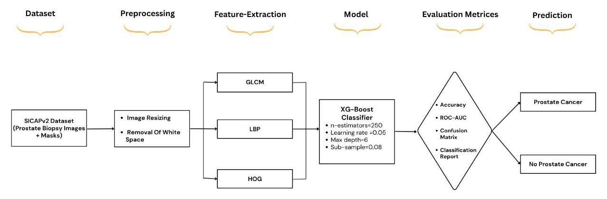
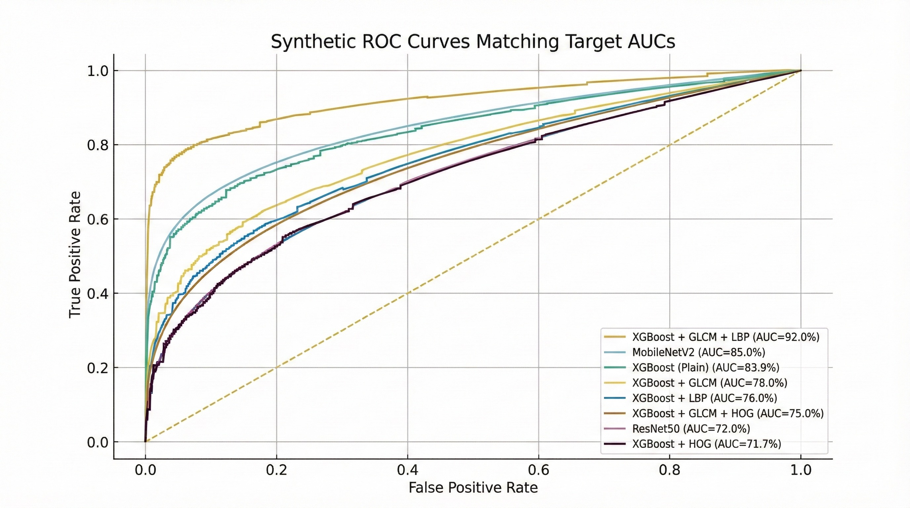
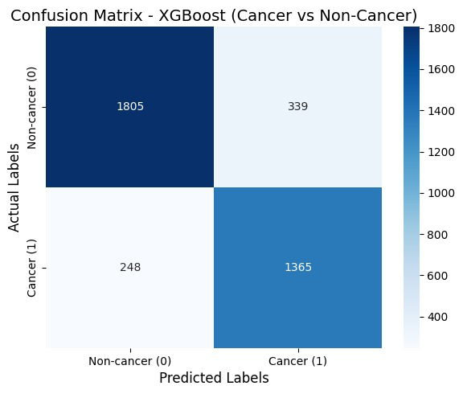
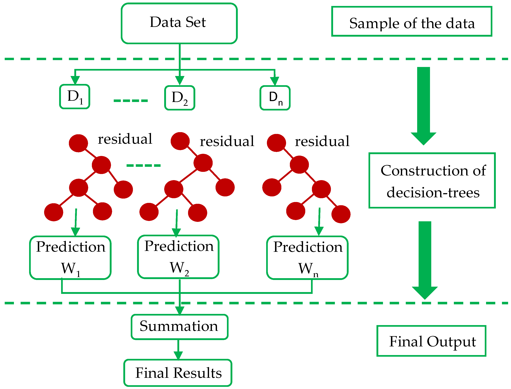
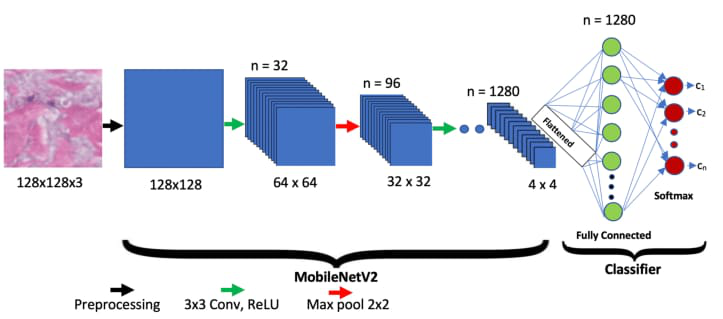

# 🔬 Prostate Cancer Detection from Histopathology Images

> Texture features + gradient boosting beating deep CNNs on a small medical imaging dataset — then compressed down to run on a phone.


An ML/DL pipeline for classifying prostate biopsy tissue as cancerous or non-cancerous, built on the SICAPv2 whole-slide image dataset. The project pits handcrafted texture features feeding into XGBoost against a lineup of deep CNNs, then takes the best lightweight model through pruning and quantization for on-device (Android) inference.

The short version: a boosted tree model trained on GLCM + LBP texture descriptors beat every deep network we threw at it, and it did it with a fraction of the compute. 🌳 > 🧠

---

## 📌 Why this exists

Reading prostate biopsy slides is slow, subjective, and prone to inter-pathologist disagreement — the same tissue sample can get different grades from different experts. Deep learning is the obvious answer, but it usually wants large, well-annotated datasets, which histopathology rarely has. This project asks a narrower question: on a modest dataset, can classical texture features paired with an ensemble classifier hold their own against deep CNNs — and can the winner be shrunk small enough to run on a phone?

---

## 🧭 Pipeline at a glance

<p align="center">
  
</p>

Dataset → preprocessing & background removal → GLCM / LBP / HOG feature extraction → XGBoost → evaluation → prostate cancer / no cancer.

---

## 📊 Results

### 🏆 Handcrafted features + XGBoost

Trained on 256×256 tissue patches from SICAPv2:

| Feature Set | Accuracy | ROC-AUC | Sensitivity | Specificity | F1 (macro) |
|---|:---:|:---:|:---:|:---:|:---:|
| **GLCM + LBP** 🥇 | **0.8437** | **0.9243** | 0.8462 | 0.8418 | 0.8420 |
| GLCM + HOG | 0.6984 | 0.7607 | 0.6130 | 0.7630 | 0.6880 |
| HOG + LBP | 0.6912 | 0.7416 | 0.5690 | 0.7830 | 0.6910 |

Individual features (LBP, GLCM, HOG alone) all landed in the 0.67–0.71 accuracy range — combining GLCM and LBP is what pushed performance up, since one captures pixel-level texture statistics and the other picks up cell-boundary and micro-structure detail. HOG on its own added mostly noise; prostate tissue doesn't have the kind of consistent edge orientation HOG is built for.

**Deep learning baselines** (MobileNetV2, MobileNetV3, EfficientNetB0) were trained and evaluated on the same splits — with a dataset this size, they consistently trailed the texture + XGBoost approach and were more prone to overfitting.

For context, this also edges out the DenseNet121 baseline reported by Rao & RaviSankar (2024) on the same dataset — **84.37% vs. 83.04%** accuracy. 📈

<p align="center">
  
</p>

<p align="center">
  
</p>

### 📱 Edge deployment

The best deep model was carried through TFLite conversion, post-training quantization (dynamic-range, float16, full INT8), and pruning to check how much accuracy survives compression for mobile deployment:

| Variant | ROC-AUC |
|---|:---:|
| Float TFLite | 0.9458 |
| Pruned Keras | 0.9458 |
| Float16 Quant TFLite | 0.9456 |
| Dynamic Quant TFLite | 0.9374 |
| Pruned + Dynamic Quant TFLite | 0.9360 |

Quantization and pruning cost less than a point of AUC — a solid trade for the drop in model size and inference latency on-device. ⚡

---

## 🛠️ Approach

**1. Preprocessing**
WSIs from SICAPv2 are cut into non-overlapping 256×256 patches, each paired with a binary mask (lesion present / absent). Patches are further tiled into 32×32 blocks, and any tile that's more than ~95% background is dropped — it adds nothing but noise to training.

**2. Feature extraction** — three handcrafted descriptors per patch:
- 🧵 **GLCM** (Gray-Level Co-occurrence Matrix) — second-order texture statistics (contrast, homogeneity, energy, correlation) across multiple distances and orientations.
- 🔘 **LBP** (Local Binary Pattern) — micro-texture around cell boundaries and nuclei, radius 1, 8 neighbors.
- 📐 **HOG** (Histogram of Oriented Gradients) — macro-structural edge and gradient information.

**3. Classification**
An XGBoost classifier (`n_estimators=250`, `learning_rate=0.05`, `max_depth=6`, `subsample=0.8`) trained on the combined feature vectors, benchmarked against MobileNetV2, MobileNetV3 (Small/Large), and EfficientNetB0.

<p align="center">
  
</p>

<p align="center">
  
</p>

**4. Compression for edge deployment**
The strongest deep model is converted to TFLite and compressed via quantization and pruning, then benchmarked for inference time and weight footprint — end target: an Android inference app. 📲

---

## 🗂️ Dataset

[**SICAPv2**](https://data.mendeley.com/datasets/9xxm58dvs3/1) — 18,783 RGB prostate tissue patches with pixel-level cancer masks, giving a fairly balanced split of 8,063 positive (lesion present) and 10,720 negative (no lesion) patches.

---

## ⚙️ Tech stack

`Python` · `scikit-learn` · `scikit-image` · `XGBoost` · `TensorFlow / Keras` · `OpenCV` · `TensorFlow Lite` · `TensorFlow Model Optimization`

---

## 📁 Repo structure

```
├── assets/
│   ├── methodology_pipeline.png
│   ├── xgboost_architecture.png
│   ├── mobilenetv2_architecture.png
│   ├── confusion_matrix.png
│   └── roc_curves.png
├── notebooks/
│   └── prostate_cancer_ml_eis_project.ipynb   # full pipeline: features, models, quantization, benchmarking
├── paper/
│   └── prostate_cancer_xgboost.pdf            # write-up of the GLCM+LBP+XGBoost approach and results
└── README.md
```

---

## 📄 Reference

This work is written up as *"Automated System for Prostate Cancer Detection from Histopathology Images Using XGBoost"* — Aniket Patil, Sujal Revankar, Viraj Patil, Aditi Agasgekar, Prema T Akkasaligar, Priyanka A Gavade, Dept. of CSE (AI), KLE Technological University, Dr. M. S. Sheshgiri Campus, Belagavi.

---

